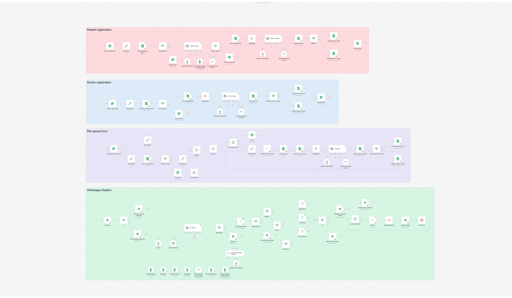
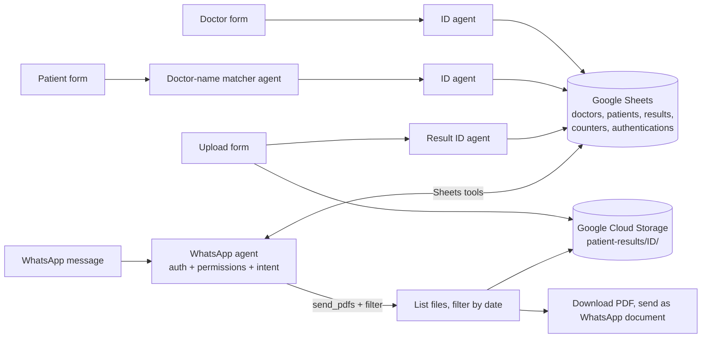
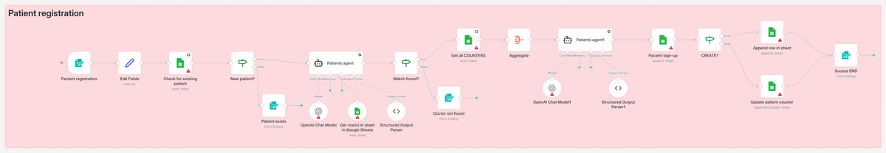
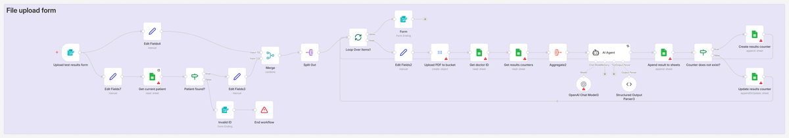
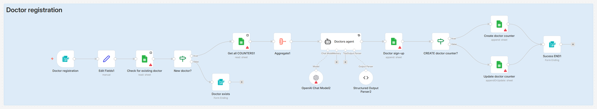
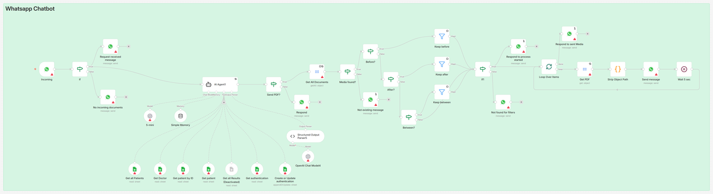

# Lab test results assistant (n8n + WhatsApp + AI agents)

An n8n workflow for a medical lab results service: doctors and patients sign up through web forms, the lab uploads test result PDFs, and patients or their doctors get the PDFs on WhatsApp by chatting with an AI assistant that first checks who they are and what they are allowed to see.

> A tour of the workflow in n8n: overview, then the four flows. To run it you need your own Google Sheets, Google Cloud Storage, WhatsApp Business and OpenAI credentials (see "How to run it"). The user-facing texts are in Romanian; the assistant answers in the user's language.

## The problem

I built this for a clinic. The idea: patients ask for their lab results on WhatsApp ("send me everything after 1 August"), doctors get the results of their own patients the same way, and nobody can get someone else's results. The clinic stopped the collaboration before the workflow was connected to their systems or to any real data.

## What it does

The workflow has four flows (one per colour on the canvas):

1. **Doctor registration** (form): name, date of birth, email, phone. Checks that the doctor does not exist yet, gives them an ID (`D-001`, ...) and saves them.
2. **Patient registration** (form): the same fields plus "your doctor's name". An AI agent matches the free-text doctor name against the doctors list (handles diacritics, swapped first/last name, "Dr.", typos; returns NONE below 0.75 confidence). Then the patient gets an ID built from their initials (`P-ABC-001`) and is linked to that doctor.
3. **Upload test results** (form): patient ID plus one or more PDF/DOC files. Checks that the patient exists, uploads each file to Google Cloud Storage under `patient-results/<patient_id>/`, gives each result an ID and records it.
4. **WhatsApp assistant**:
   - only text messages are accepted; the user immediately gets a "preparing the answer" message
   - the AI agent (gpt-5-mini, with memory per phone number) first checks if this WhatsApp number is already authenticated; if not, it asks for date of birth and email and matches them, together with the phone number, against the patients and doctors sheets; authentication is valid for 30 days
   - **patients** can only get their own PDFs and their own name, date of birth and email
   - **doctors** can list their assigned patients and get those patients' PDFs, never other doctors' patients
   - requests can be filtered by date ("before", "after", "between"); ambiguous ones ("from 15 August") get a clarifying question, and requests for two people at once are refused
   - when the agent decides to send, the workflow lists the patient's files in the bucket, applies the date filter, downloads each PDF, cleans the file name and sends it as a WhatsApp document

The agent always answers with a fixed JSON structure (reply, intent, role, patient ID, date filter, ...), validated by an output parser, so the rest of the workflow branches on fields instead of free text.

## Architecture

| Patient registration | Upload test results |
|---|---|
|  |  |

| Doctor registration | WhatsApp assistant |
|---|---|
|  |  |

## Prompts

Each agent's system prompt, input and output format, one file per agent, copied from the workflow file:
- [WhatsApp assistant](prompts/whatsapp-assistant.md): authentication, permissions, date filters, the JSON answer
- [Doctor-name matcher](prompts/doctor-name-matcher.md)
- [Patient ID agent](prompts/patient-id-agent.md), [Doctor ID agent](prompts/doctor-id-agent.md), [Result ID agent](prompts/result-id-agent.md)

## Tech stack

n8n (Form Trigger, AI Agent, Structured Output Parser with auto-fix, Simple Memory, Google Sheets and Google Sheets tool nodes, Google Cloud Storage, WhatsApp Business Cloud trigger and send, Code node, If/Filter/Loop), OpenAI API (gpt-5-mini, gpt-4.1-mini, gpt-4o).

## How to run it

1. Import `workflow/lab-results-assistant.workflow.json` into n8n (Workflows > Import from file). Import tested on n8n 2.4.7.
2. Create credentials and select them in the nodes: OpenAI, Google Sheets (OAuth), Google Cloud Storage.
3. **Set up WhatsApp on Meta's side.** A phone number alone is not enough; the bot needs the WhatsApp Business Platform:
   - a Meta developer account, a Meta business portfolio and a business app in Meta for Developers with the WhatsApp product added
   - a phone number registered on that app (Meta gives you a test number to start with) and its phone number ID
   - an access token and the WhatsApp Business Account ID for n8n's "WhatsApp" credential (used by the send nodes)
   - the app's ID and secret for n8n's "WhatsApp OAuth" credential (used by the WhatsApp Trigger, which registers the webhook for incoming messages)
4. Create a Google Sheet with the tabs `doctori`, `pacienti`, `rezultate-analize`, `counters`, `authentications` (column names are visible in the Sheets nodes) and select it where you see `<LONG_ID_1>`. Create a bucket and set its name in the Cloud Storage nodes.
5. Put your phone number ID in the WhatsApp send nodes (`<PHONE_…>` placeholders) and your bot's number in the form completion messages.
6. Activate the workflow, register a doctor and a patient through the forms, upload a PDF, then write to the bot on WhatsApp.

### Placeholders

Credentials, webhook IDs and pinned data are not in this repo. The spreadsheet ID, phone numbers, emails and URLs are replaced by placeholders such as `<LONG_ID_1>` or `<PHONE_2>`; the same value always gets the same placeholder.

## My contribution

Solo project: I built this workflow in n8n, including the agents' prompts.

**About this repository:** the workflow is mine. I exported and packaged it for GitHub (this README, screenshots, demo GIF, removing private data) with help from an AI assistant, which is why the single commit lists Claude as co-author.

## Status and limitations

- **Never used with real people or real data.** Only I tested it, with test data.
- The "Get all Results" tool and rate limiting are switched off.
- **Authentication and permissions are decided by the AI agent, following [the prompt](prompts/whatsapp-assistant.md).** The Sheets tools themselves do not enforce roles: for example, the doctor filter in "Get all Patients" is a value the model fills in. A successful prompt injection could make the agent read data it should not. The prompt is strict about this, but it is not a guarantee.
- **IDs are allocated by an LLM** reading a counters sheet and returning the next number. That is not deterministic and two sign-ups at the same time could get the same number.
- Medical data (names, dates of birth, phone numbers, result files) lives in Google Sheets and a bucket; there is no consent flow, retention policy or audit log.
- The date filter uses the file's upload/storage time in the bucket, not the date of the test.
- Phone normalization assumes Romanian numbers (country code 40).

## What I would change for production

- Move authentication and authorization into code: a one-time code sent on WhatsApp, a session table, and tools that only accept the authenticated user's ID (never a value chosen by the model).
- Put a prompt-injection filter in front of the agent: a small classifier model (for example Meta's Prompt Guard or Azure Prompt Shields) that checks every incoming message and blocks suspicious ones before they reach the real agent. This is one extra layer, not a replacement for the permission checks in code above.
- Allocate IDs with code (a Code node or a database sequence), not with a model.
- Replace Google Sheets with a real database (for example Postgres) with encryption, access logs, consent and retention rules suitable for health data (GDPR).
- Store the test date as metadata and filter on it.
- Add evaluation conversations (impersonation attempts, two patients in one message, ambiguous dates) and run them after every prompt change.
